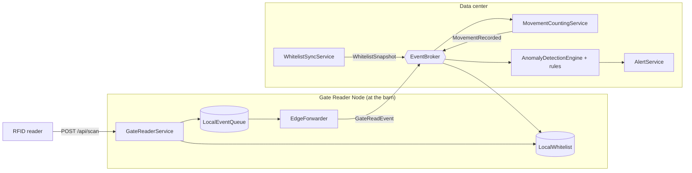

# VinaBeef Livestock Management: RFID Gate

Java 21 / Spring Boot implementation of the **RFID gate** from the M1 design (Movement Counting and Alerting
subsystem: event-driven architecture with edge computing). Cattle wear ISO 11784/11785 RFID ear tags; each
barn gate has a reader and a Gate Reader Node that records every passage, even when the farm network is down.

| Covered | Requirement |
| --- | --- |
| ✔ | FR-03 Automated in/out movement recording and counting |
| ✔ | FR-04 Alerts for unregistered, inactive (sold/dead) and wrong-barn cattle, and for missing cattle |
| ✔ | NFR-01 Gate decision ≤ 2 s (decided locally at the gate, measured per read) |
| ✔ | NFR-02 No loss of movement records (durable edge queue, at-least-once delivery, idempotent recording) |
| seed data only | FR-01 / FR-02 Cattle, tags, barns and gates (fixed demo data, read-only API) |
| not in this demo | Notification Service, Gate Health Monitor, registry editing, administration/RBAC, health, reporting |

## Run

```bash
mvn spring-boot:run        # then open http://localhost:8080
mvn test                   # 16 tests: unit + end-to-end pipeline
```

Demo data (one Dak Lak site, 2 barns, 3 gates, 6 cattle including one SOLD animal) is created at startup.
H2 console: `/h2-console` (JDBC URL `jdbc:h2:mem:vinabeef`).

### Demo script

1. **Live gate simulation**: send VN-0001 OUT through `DL-A01-G1`. The trace shows the read classified at the
   gate in a few milliseconds, queued, forwarded and recorded.
2. **Network outage**: press *Cut WAN link* for DL-A01 and send more cattle. Reads are still accepted and counted
   as *held at edge*. Press *Restore WAN link*: they are forwarded in order, recorded once, and marked
   *held N s at edge*.
3. **Unexpected animals**: send VN-0004 (belongs to DL-A02) through `DL-A01-G1`, the SOLD VN-0006, or an
   *Unregistered tag*. Each raises an alert.
4. **Missing animals**: send cattle OUT, bring only some back IN, then press *End session* on the dashboard.
   A `MISSING_CATTLE` alert lists who did not return.

## Architecture in the code

The gate side (Gate Reader Node) and the central side run in one process for the demo. They communicate only
through the `EventBroker` interface and the message records in `shared.contract`, as they would over Kafka.
The `edge` package never imports a central module.



| M1 component | Package / class |
| --- | --- |
| Gate Reader Service | `edge.GateReaderService`, `edge.web.GateReaderController` (`POST /api/scan`) |
| Local whitelist cache | `edge.whitelist.LocalWhitelist` → `InMemoryLocalWhitelist` |
| Local Event Queue (store-and-forward) | `edge.queue.LocalEventQueue` → `JpaLocalEventQueue`; relay `edge.EdgeForwarder` |
| Event Broker (Kafka) | `shared.messaging.EventBroker` → `InProcessEventBroker` |
| Movement & Counting Service | `movement.application.MovementCountingService`, domain `Movement`, `HerdSession` |
| Anomaly Detection Engine | `anomaly.AnomalyDetectionEngine`, rules in `anomaly.rule`, `anomaly.MissingCattleDetector` |
| Whitelist Sync Service | `whitelist.WhitelistSyncService` (publishes the snapshot once at startup) |
| RFID tag format | `shared.rfid.TagFormat` → `Iso11784TagFormat` |
| Master data (seeded) | `registry` (read-only `CattleDirectory`, `GateDirectory`), `demo.DemoDataSeeder` |

### What happens to one read

1. `GateReaderController` receives the tag from the reader.
2. `GateReaderService` validates the tag, works out the direction from the gate type, checks the local
   whitelist and **saves the event to the local queue before answering**. No network call is made, so the
   answer takes a few milliseconds (NFR-01) and nothing is lost if the WAN is down (NFR-02).
3. `EdgeForwarder` sends queued events to the broker every 0.5 s while the barn's link is up, in arrival order,
   and marks each one forwarded only after the broker accepts it.
4. `MovementCountingService` stores the movement and updates the barn's herd session. The edge-generated
   `eventId` is the primary key, so a re-sent event is never stored twice.
5. `AnomalyDetectionEngine` runs after the movement is committed. It checks the movement against the
   authoritative registry with each `MovementRule` and raises an alert per finding.

## SOLID in this code

| Principle | Where |
| --- | --- |
| **Single responsibility** | Reading (`GateReaderService`), forwarding (`EdgeForwarder`), recording and counting (`MovementCountingService`), detecting (`AnomalyDetectionEngine`) and storing alerts (`AlertService`) are separate classes. `HerdSession` owns the counting rule. `ApiExceptionHandler` owns error mapping, so controllers have no try/catch. |
| **Open/closed** | A new anomaly rule is a new `MovementRule` bean; the engine does not change. A new tag scheme is a new `TagFormat`. Each `GateType` derives its own direction. Kafka would replace the broker by implementing `EventBroker`. |
| **Liskov substitution** | `LocalEventQueue` states its contract (store durably, keep per-site order). The unit test swaps in an in-memory queue and the gate behaves the same. Every `MovementRule` is side-effect free, so the engine runs them interchangeably. |
| **Interface segregation** | Detectors depend on `AlertRaiser` (raise only), not the whole `AlertService`. Other modules read the registry through `CattleDirectory` and `GateDirectory`, never its repositories. |
| **Dependency inversion** | Policies depend on interfaces: `EventBroker`, `LocalEventQueue`, `SiteUplink`, `LocalWhitelist`, `TagFormat`, `Clock`. The edge depends only on `shared.contract` messages. |

## API

| Method & path | Purpose |
| --- | --- |
| `POST /api/scan` | RFID read `{rfidTag, gateId, direction?, timestamp?}` → 202 with the gate's local decision |
| `GET /api/edge/status` · `PUT /api/edge/sites/{barnId}/link` | Edge queue and whitelist state · simulate the WAN going down/up `{online}` |
| `GET /api/movements` · `/api/movements/count` · `/api/movements/{eventId}` | Movement history |
| `GET /api/herd-sessions` · `POST /api/barns/{barnId}/herd-session/close` | Open sessions · end one (missing check) |
| `GET /api/alerts` · `/api/alerts/open-count` · `POST /api/alerts/{id}/acknowledge` | Alerts |
| `GET /api/gates` · `GET /api/cattle` | Seeded master data |

Errors follow the M1 interface spec: HTTP status + `{code, message}`.
Example read: `{"rfidTag":"704000000000001","gateId":1,"direction":"OUT"}`.

## Demo simplifications

| Production design | Demo |
| --- | --- |
| Kafka | `InProcessEventBroker` (synchronous Spring events) |
| SQLite queue + whitelist on each Gate Reader Node | `edge_event_queue` table and in-memory whitelist in the same process |
| PostgreSQL | In-memory H2 |
| Whitelist republished on every registry change | Published once at startup (registry is fixed seed data) |
| Real WAN failures | `SimulatedSiteUplink`, switched from the dashboard |
